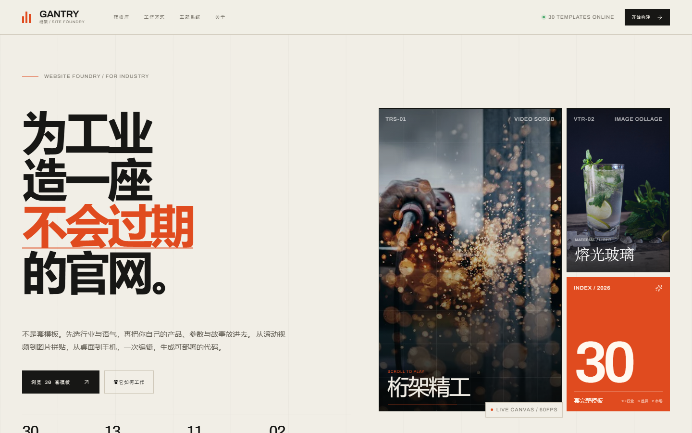

# GANTRY / 桁架

> 一个面向工业品牌的低代码官网铸造厂。选行业 → 选风格 → 换内容 → 生成可部署的单文件 HTML。



## 这是什么

GANTRY 不是一个「套模板」的建站页面，而是一套把官网拆成**叙事组件**的编辑器：

- **715 套完整模板**：13 个行业 × 11 种风格，每个组合恰好 5 套；含 30 套手工模板与 685 套模板工厂生成内容。覆盖机械、玻璃、商品、半导体、能源、机器人、仪器、建筑、五金、物流、化工、医疗器械、汽车零部件。
- **7 种首屏叙事**：滚动视频、图片拼贴、分栏编辑、全幅影像、动态字、产品舞台。
- **18 套主题**：只改变纸张、油墨、强调色、字体、圆角与网格，不改变内容结构；含美式工坊、德式精密、意式社论、日式极简、北欧功能。
- **组件级样式**：每个区块可单独调布局、密度、对齐、表面、媒体比例、列数、遮罩与动效，并随 JSON / HTML 一起导出。
- **图片焦点与缩放**：首屏图、拼贴图、产品图都可调焦点 X/Y 与 1–2.5× 缩放，不改原图。
- **桌面 / 手机双视图**：手机不是桌面缩小版，而是同一份内容的重新排版。
- **就地编辑**：标题、参数、产品图、客户证言可以直接在画布上点开改。
- **代码导出**：单文件 HTML，内嵌样式、图片、视频与滚动脚本；也可导出 JSON 接 CMS。

## 技术栈

| 层 | 选型 |
| --- | --- |
| 框架 | React 19 + TypeScript 5.9 |
| 构建 | Vite 7 |
| 状态 | Zustand 5（localStorage 持久化、撤销 / 重做） |
| 动效 | Motion + CSS scroll-driven 逻辑 |
| 图标 | lucide-react |
| 单元测试 | Vitest + Testing Library + jsdom |
| 端到端测试 | Playwright（Chromium） |
| 代码质量 | ESLint 9 flat config + `tsc --noEmit` |

选 React 而不是继续 Angular，是为了把「模板即组件、主题即变量」做成可复用的开源叙事；项目里保留了 Angular 经验里最重要的部分：类型约束、模板体系、复杂状态与工程化。

## 快速开始

```bash
npm install
npm run dev        # http://127.0.0.1:5174
npm run test       # 147 个单元测试
npm run test:e2e   # 19 条 Playwright 用例
npm run build      # 类型检查 + 生产构建
npm run lint
```

> 本机 npm 需要把 cache 指到可写目录，例如：
> `npm_config_cache=C:\Users\Assassin\OneDrive\文档\deepseek-harness\default-workspace\.npm-cache`

## 六个可以立刻试的交互

1. **筛选模板**：在模板库先按「国际市场」切到 10 套英文模板，再按「玻璃与器皿」找到熔光玻璃与 LUMEN GLASS；搜 `TRS-01` 回到桁架精工。
2. **滚动视频**：打开「桁架精工」，在画布里向下滚动。首屏视频的 `currentTime` 跟随滚动位置，不是自动播放。
3. **就地改字**：点首屏大标题，直接改成你的产品主张；`Esc` 取消，失焦保存。
4. **换主题**：右侧「主题」里点「熔融玻璃」，纸张、油墨、强调色、字体一起变，但八段结构不变。
5. **生成代码**：右侧「导出」→「下载单文件 HTML」或「下载整站 ZIP」。生成要求先登录；登录后项目同时保存到云端。
6. **跨设备接力**：注册后打开模板、添加页面、点「云端」。回到模板库点用户名，从云端项目重新打开，两个页面与内容一起回来。

## 模板矩阵

| 模板 | 行业 | 风格 | 首屏 | 主题 |
| --- | --- | --- | --- | --- |
| 桁架精工 TRS-01 | 机械与零件 | 工业编辑 | 滚动视频 | 热轧钢 |
| 熔光玻璃 VTR-02 | 玻璃与器皿 | 玻璃奢华 | 图片拼贴 | 熔融玻璃 |
| 货运工业 CRG-03 | 工业商品 | 温暖手作 | 分栏编辑 | 牛皮纸 |
| 基底半导体 SUB-04 | 半导体 | 暗色精密 | 产品舞台 | 洁净室 |
| 并网能源 GRD-05 | 新能源 | 工业编辑 | 全幅影像 | 高压电场 |
| 动能协作 KNT-06 | 机器人 | 动能粗野 | 动态字 | 动能黄 |
| 轨道仪器 ORB-07 | 仪器 | 瑞士网格 | 分栏编辑 | 实验室白 |
| 立面建筑 FCD-08 | 建筑 | 工业编辑 | 图片拼贴 | 建筑灰 |
| 铸造之夜 FRG-09 | 机械与零件 | 工业编辑 | 滚动视频 | 铸造夜 |
| 包装产线 PCK-10 | 工业商品 | 工业编辑 | 产品舞台 | 信号蓝 |
| ATLAS MACHINE WORKS ATL-11 | 机械与零件 | 美式工坊 | 滚动视频 | 铸造夜 |
| NORDWERK NRD-12 | 仪器 | 德式精密 | 分栏编辑 | 石墨灰 |
| LUMEN GLASS LUM-13 | 玻璃与器皿 | 意式社论 | 图片拼贴 | 意式工坊 |
| KISO WORKS KSO-14 | 仪器 | 日式极简 | 产品舞台 | 和纸 |
| OSLO ENERGY OSL-15 | 新能源 | 北欧功能 | 全幅影像 | 峡湾 |
| 恒锻五金 HDW-16 | 五金与紧固件 | 工业编辑 | 产品舞台 | 合金 |
| 固联紧固件 HDW-17 | 五金与紧固件 | 瑞士网格 | 分栏编辑 | 石墨灰 |
| NORTHBOLT NBT-18 | 五金与紧固件 | 美式工坊 | 滚动视频 | 热轧钢 |
| 港联物流 LGC-19 | 物流与仓储 | 瑞士网格 | 全幅影像 | 货运 |
| 冷链方舟 LGC-20 | 物流与仓储 | 暗色精密 | 图片拼贴 | 信号蓝 |
| FREIGHTLINE FRL-21 | 物流与仓储 | 北欧功能 | 分栏编辑 | 峡湾 |
| 试剂科技 CHM-22 | 化工与材料 | 暗色精密 | 滚动视频 | 试剂 |
| 高分子工场 CHM-23 | 化工与材料 | 工业编辑 | 图片拼贴 | 牛皮纸 |
| HELIX CHEMICAL HLX-24 | 化工与材料 | 德式精密 | 产品舞台 | 石墨灰 |
| 精工医疗 MED-25 | 医疗器械 | 瑞士网格 | 分栏编辑 | 实验室白 |
| 无菌系统 MED-26 | 医疗器械 | 玻璃奢华 | 全幅影像 | 外科 |
| MERIDIAN MEDICAL MRD-27 | 医疗器械 | 北欧功能 | 产品舞台 | 外科 |
| 驱动汽车 AUT-28 | 汽车零部件 | 动能粗野 | 动态字 | 动能黄 |
| 精铸汽车 AUT-29 | 汽车零部件 | 暗色精密 | 图片拼贴 | 铸造夜 |
| APEX MOBILITY APX-30 | 汽车零部件 | 德式精密 | 分栏编辑 | 合金 |

## 结构

```text
src/
  components/
    gallery/     模板库（市场 / 行业 / 风格 / 搜索）
    builder/     顶栏、页面轨道、画布、检查器、预览
    site/        站点渲染器：7 种首屏 + 8 类区块
    editor/      可编辑文本
  data/          分类、主题、模板内容（715 套）
  lib/           滚动进度、区块工厂、SectionStyle、主题 token、图片焦点、HTML/ZIP 导出、API 客户端
  store/         Zustand 编辑器状态 + 云端项目/多页状态
  styles/        shell.css（产品壳）+ site.css（站点主题引擎）
e2e/             Playwright 端到端
scripts/         截图脚本
```

## 工作流

- 第一步已完成：30 套模板、市场筛选、桌面/手机编辑器、组件级样式、图片焦点与独立裁剪、HTML/项目源文件导出。
- 第二步已完成：[工作流文档](../docs/WORKFLOW.md) 定义 30 套模板、组件级样式、图片裁剪、主题 token、源码导出鉴权与会员/支付边界。
- 第三步已落地 Phase 1–4：主题 token、SectionStyle、媒体焦点、30 套模板、登录与云端项目、多页编辑、HTML/ZIP 导出、登录闸门。
- 第四步前端验收记录：[验收文档](../docs/ACCEPTANCE.md)。

## 已验证

- `npx tsc --noEmit` 通过。
- `npx vitest run`：23 个测试文件，147 个测试通过。
- `npx playwright test`：28 条用例通过（715 套模板分页、市场/行业/风格筛选、手机无横向溢出、登录闸门、编辑/主题/设备/预览/导出、滚动视频、独立裁剪、页面导航切页、画布编辑、CTA、语言菜单、30 套精选 smoke、云端多页往返）。
- `npm run build` 通过（1665 模块；首屏 `index` 478.44 kB / gzip 159.60 kB；按需 `Builder` 365.86 kB / `Gallery` 16.35 kB；CSS 104.77 kB / gzip 19.48 kB）。
- `npm run lint` 0 error / 0 warning。
- 导出 HTML 已在 Playwright 里用 `file://` 实际打开，标题与 8 个区块均存在。
- 云端流程已用 Playwright 注册账号、创建两页、保存、从云端重开并验证页面标题。
- 七语言界面（zh-CN / en / ar / tr / he / fa / ur），阿拉伯语/希伯来语/波斯语/乌尔都语 RTL；站点语言可在主题面板单独设置，导出写入 `lang`/`dir`。

## 当前边界

- 多页编辑与整站 ZIP 已可用；单页 HTML 仍是主要交付物。
- 国际模板已有英文文案与英文导航；更细的本地化（货币、地址格式、合规文案）在下一阶段。
- 图片可调焦点与缩放，也有独立裁剪弹窗；还没有压缩质量与格式选择。
- 导出为 HTML / 整站 ZIP / 项目 JSON；React 源码生成、支付仍未接入。
- 编辑器定位是桌面工作台；手机视图用于预览成品，不是手机端编辑器。
- 需要先运行 `backend` 的 Spring Boot 服务，登录、云端保存与云端项目才能工作。

## 下一步

后端已落在 `backend/`：Spring Boot 3.5.6、JWT、项目/页面、乐观锁、HTML/JSON 导出。下一步按 [工作流文档](../docs/WORKFLOW.md) Phase 5 接入真实源码生成、支付与生产部署；Phase 6 做全量视觉回归与最终验收。
